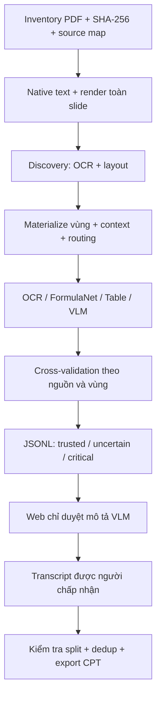

# Đặc tả chính thức — Data preprocessing v5

**Cập nhật vận hành 21/10/2026:** luồng toàn corpus dùng [bộ điều phối Colab tuần tự và 14 input cân bằng](colab_orchestrator_v2/README.md). Mỗi lượt upload một file, xử lý, tải kết quả và xác nhận rồi mới sang file tiếp. Core v5.0.0/prompt/cổng kiểm duyệt giữ nguyên; với học phần chưa chuẩn bị, lớp điều phối chạy thêm native/render trên Colab để tự nối discovery với inference. Snapshot release đã đóng băng không bị chỉnh sửa. Các đường chạy từng packet trong tài liệu vẫn được giữ để đối chiếu.

| Thuộc tính | Giá trị |
|---|---|
| Phiên bản phát hành | **5.0.0 — v5** |
| Trạng thái | **OFFICIAL_BASELINE**, theo lựa chọn của người dùng |
| Ngày chốt | **21/10/2026**, Asia/Bangkok |
| Entrypoint chính thức | `D:\BKQuiz\AI\data_preprocessing\manage.py` |
| Chỉ định phiên bản | `AI/data_preprocessing/CURRENT.json` |
| Mã chạy cố định | `AI/Qwen_cpt_version/region_preprocessing_v5_0_1/` |
| Cấu hình corpus | `AI/data_preprocessing/production.json` |
| Mục tiêu | Native + OCR + VLM + Cross-validation + Human Review, tạo dữ liệu truy vết được cho continued pretraining |

“Chính thức” xác định phiên bản mặc định và hợp đồng vận hành. Nó không đồng nghĩa mọi đầu ra đã đúng, mọi slide đã được xử lý hoặc model đã đạt điểm chất lượng nào. Kết quả v1–v4, run v5 cũ, cache và lịch sử người duyệt được giữ nguyên.

## 1. Phạm vi đầu vào

Đợt corpus hiện tại gồm **27 PDF học phần, 13.314 trang, 621.755.869 byte** tại `D:\bk_quizz_data\slide_processed\pdf`. Kiểm kê dựa trên file thực tế, không dùng con số 23 trong README nguồn đã cũ. Cả 27 SHA-256 khớp manifest upstream; giữ snapshot manifest và ánh xạ trang nguồn.

Chỉ xử lý một bản cho mỗi PDF có SHA-256 giống hệt. ZIP/PDF ở thư mục `slide` là nguồn gốc của các PDF chuẩn hóa, không nhập lại như tài liệu mới. Thư mục đề thi, tài liệu được upstream loại khỏi slide và `_work` không thuộc đợt này. Để mở rộng corpus phải tạo inventory/plan mới, ghi rõ phạm vi.

PPTX gốc được ưu tiên khi được ghép cặp rõ với PDF và có ánh xạ slide phù hợp. Không suy đoán hai tài liệu tương ứng chỉ vì giống tên. Hiện đợt này dùng 27 PDF chuẩn hóa; source PPTX trong archive không được tự tách và ghép lại.

## 2. Kiến trúc và phân công

| Thành phần | Công cụ | Vai trò và giới hạn |
|---|---|---|
| PDF/native/render | PyMuPDF 1.28.2 | Text, span bbox, raster image, ảnh toàn trang |
| PPTX nếu có pairing | python-pptx 1.0.2 | Shape/table/chart và drawing order; không tự coi drawing order là reading order đã đúng |
| Layout độc lập | Docling 2.140.0 | Reading order, table/image/formula candidates nếu parser trả; giữ raw |
| OCR/layout/chuyên gia | PaddleOCR 3.7.0, PaddleX 3.7.2, Paddle GPU 3.2.2 | OCR tiếng Việt, PP-StructureV3 và PP-FormulaNet-S; mỗi worker/process riêng |
| OCR tiếng Việt | PP-OCRv3, `lang=vi` | Không lấy confidence làm accuracy; không xóa native đúng để thay bằng OCR lỗi |
| Công thức | PP-FormulaNet-S | Chỉ nhận region loại formula; bảng/đoạn văn không được đưa mù quáng vào math model |
| Bảng | PP-StructureV3 | Pipeline sở hữu preprocessing/OCR; không giả lập `doc_preprocessor_res` |
| Parser bổ sung | MinerU 4.0.12, tùy chọn | Adapter độc lập; không bắt buộc cho tiến trình mặc định |
| VLM | Qwen2.5-VL-7B-Instruct NF4 | Một ảnh → một mô tả tự nhiên; chỉ facts nhìn rõ |
| Ảnh | Pillow/OpenCV/ImageHash | Crop, context, độ nét, pixel hash và perceptual-hash candidates |
| Schema/logic | Python + Pydantic 2.14.1 | Schema record nội bộ; không ép VLM sinh JSON |
| Human review | Python HTTP server + HTML/JS + SQLite | Chỉ xác nhận đầu ra VLM thành công |
| Tích hợp annotation | Label Studio export/import, tùy chọn | Chỉ annotation người thật có nguồn; predictions không là approval |

V5 dùng lại layout/chuyên gia IT3170 đã có và đúng hash. Đối với 26 học phần mới, phải thu thập và materialize layout trước pha inference; không được coi chỉ trích raster ảnh là phát hiện đủ công thức, bảng và vector.

## 3. Quy trình theo tài liệu

### 3.1 Inventory và native

- Mỗi tài liệu có `document_id = course_code + SHA256_prefix`, tên gốc, đường dẫn, SHA đầy đủ, số trang, dung lượng và trạng thái đọc/mã hóa.
- Inventory đọc mẫu đầu/giữa/cuối để khảo sát text; mẫu này không phải benchmark chất lượng hay kiểm chứng toàn bộ trang.
- Native preparation đọc toàn bộ tài liệu, lưu render RGB khoảng 1.400 pixel chiều rộng cho từng slide. Text/span nguồn, số và ký hiệu được giữ.
- Phân loại theo presence: dưới 10 ký tự → scanned/visual-only; có ảnh và dưới 80 ký tự → mixed; còn lại native-text. Đây không phải khẳng định trang ít chữ không có kiến thức.
- Ảnh lặp nhiều vị trí phải có region ID riêng cho từng occurrence; không ghi đè crop vì dùng chung PDF xref.

### 3.2 Discovery và materialization

Tài liệu mới chạy pha **discovery** theo từng gói: OCR, PP-Structure layout và Docling. Không chạy Qwen trong pha này. Output lỗi vẫn phải lưu nguyên văn, traceback, phiên bản và hash.

Sau import, adapter tạo region cho formula/table/image/diagram/chart có bbox hợp lệ. Bbox thiếu/sai hoặc page không ánh xạ được vào nguồn phải vào quarantine/import receipt, không đoán tọa độ. Giữ exact crop, crop ngữ cảnh và ảnh toàn slide.

`layout_pages_processed` theo dõi trang đã qua parser; chỉ sau khi phủ toàn bộ tài liệu mới đặt `layout_inventory_status=ready` cho việc định tuyến. `ready` ở đây là hoàn thành bước kỹ thuật, không khẳng định information coverage 100%.

Vùng parser cùng loại và IoU ≥ 0,9 với vùng đã có được đối chiếu thay vì tạo bản sao. Region ID mới ràng buộc SHA tài liệu, trang, loại và bbox. Nguồn ký tự lỗi vẫn được lưu để đối chiếu, không tự sửa kiến thức.

### 3.3 Định tuyến và giới hạn VLM

Điểm sàng lọc:

\[
S=4D+3C+2U+R-4B-3E
\]

- D: nhãn/caption có bằng chứng đồ thị hoặc sơ đồ; C: chart; U: còn nội dung hình chưa được giải thích.
- R: vùng tương đối lớn nhưng ít native text. B: bằng chứng trang trí từ rule lặp pixel ở vùng mép nhỏ. E chỉ được dùng khi có bằng chứng specialist đã xử lý đầy đủ; adapter corpus hiện giữ E=false thay vì tự suy diễn thành công ngữ nghĩa.
- Ứng viên mới có S≥5 được xếp ưu tiên; mục tiêu khoảng 5% trang, giới hạn cấu hình 8%. Không ép đủ quota nếu không có ứng viên cần VLM.
- Trang nhiều vùng vẫn chỉ tính một lần vào tỷ lệ trang; số lời gọi model là số crop, phải báo riêng.
- Phần vượt ngân sách hoặc chưa đủ bằng chứng được giữ `score_review`/deferred, không bị xóa và không tự coi đã xử lý xong.
- Ảnh pixel trùng tạo liên kết canonical. Phash gần giống chỉ là gợi ý, không dùng để xóa hình có thể khác số, hướng hoặc trạng thái.
- Rule trang trí hiện yêu cầu pixel giống hệt trên ít nhất ba trang, diện tích ≤2,5%, nằm ở mép trên/dưới. Đây là bằng chứng rule, không phải người đã xác minh mọi logo; dữ liệu gốc vẫn còn.
- Tài liệu rất ngắn có thể phải làm tròn một trang, khiến tỷ lệ vượt 8%; phải ghi `small_document_rounding_exception`, không giấu mẫu số.

IT3170 giữ lịch đã có **56/1.060 trang = 5,28%**, không chạy lại materialization để thay đổi inventory đã hiệu chỉnh. `--all-visuals` là chế độ mở rộng tường minh ở CLI kỹ thuật; batch chính thức mặc định không dùng và kiểm tra ngân sách trước khi phát hành gói.

### 3.4 Inference

| Loại vùng | Nhánh mặc định |
|---|---|
| Text/code | Native và OCR |
| Formula | FormulaNet; giữ native/math symbols để đối chiếu |
| Table | Table recognition, HTML/cell structure được giữ |
| Diagram/chart/image đã định tuyến | Qwen VLM |
| Không biết loại, hình mờ hoặc bbox thiếu | Giữ chẩn đoán/deferred, không tạo facts để đủ dữ liệu |

Đoạn dài bị parser gắn formula nhưng không có dấu hiệu toán được giữ lại và gắn `specialist_disabled`; không chạy FormulaNet chỉ để có một kết quả. Seed specialist chỉ được tái sử dụng khi nguồn/crop/config phù hợp; `0 request` vì có seed không được báo là nhận dạng mới thành công.

Lỗi specialist cũ trên crop không đổi được giữ deferred bằng `skip_specialist`; không chạy lại mù quáng 41 công thức lỗi cũ. Chỉ chạy lại khi đã có thay đổi crop/config hoặc thao tác rerun tường minh; kết quả cũ vẫn còn trong audit.

## 4. Hợp đồng VLM cố định

- Model chính thức: `Qwen/Qwen2.5-VL-7B-Instruct`, revision `cc594898137f460bfe9f0759e9844b3ce807cfb5`.
- NF4 double quantization, FP16 compute, SDPA, một ảnh mỗi lần sinh, `do_sample=false`.
- Tối đa **512 visual token**, **512 output token**, prompt text budget 1.024 token; resize theo grid 28. Tối thiểu khoảng 64 visual token khi crop quá nhỏ.
- Runtime VLM: Torch 2.6.0, Transformers 4.57.6, bitsandbytes 0.48.1; chạy tách Paddle/Docling.
- Prompt gốc là `vlm_worker.py::PROMPT`, giữ SHA trong manifest. Không JSON, không inventory node/cạnh bắt buộc, không yêu cầu tự kiểm chứng nhiều vòng.
- Được mô tả phần nhìn rõ và nói phần mờ/thiếu; không giải bài tập, đoán đáp án hoặc bổ sung facts từ kiến thức ngoài ảnh.
- Không retry schema tự động. Khởi tạo lỗi không tải model lại cho từng ảnh. Lỗi một ảnh sau khi model khởi tạo không chặn các ảnh sau.
- Cache thành công ràng buộc source/crop/context/target bbox/prompt/model/runtime. Đầu ra từng attempt không bị ghi đè. Chạy lại lỗi cần thao tác tường minh.
- Plain text trả về được code đóng vào JSON record. JSON nội bộ hợp lệ không chứng minh text model đúng.

## 5. Schema và truy vết

| Trường | Quy ước |
|---|---|
| `id`, `page`, `kind` | ID ổn định trong run; page 1-based của PDF gốc; loại được liệt kê rõ |
| `bbox`, `context_bbox` | `[left,top,right,bottom]`, gốc trên trái, chuẩn hóa [0,1000] |
| `source_sha256` | Hash PDF gốc đầy đủ, kể cả khi packet chỉ chứa 100 trang |
| `render/crop/context_path` và SHA | File bằng chứng + checksum; không đổi âm thầm |
| `native_text`, `candidates` | Giữ riêng đầu ra từng engine và backend lineage |
| `proposed_text` | Đề xuất được chọn theo loại dữ liệu, chưa phải human gold |
| `machine_bucket`, `reasons`, `risk` | Phân nhóm kỹ thuật/rủi ro và nguyên nhân |
| `machine_revision` | Hash payload máy + provenance dùng để phát hiện review stale |
| `group_id`, `split` | Nhóm chống rò rỉ và train/development/holdout |
| `semantic_verified` | Không tự chuyển thành true vì model/API/schema thành công |

Packet chứa `parser_input.pdf` là subset, `page_map` chuyển page subset về page gốc, requests, config và hash mã runtime. Không dùng hash subset thay source SHA. Import phải kiểm ZIP CRC, danh tính packet, request, config, source/crop/context và trạng thái ảnh hiện tại.

Các file chính của run: `manifest.json`, `records.jsonl`, `document_pages.jsonl`, `assets/`, `machine_snapshots/`, `external_raw/`, `import_receipts/`, `routing_summary.json` và `human_reviews.sqlite3`.

## 6. Cross-validation và ba nhóm

Không bỏ phiếu đa số. Native PDF và Docling native cùng nguồn không được tính như hai OCR độc lập; các nhánh dùng Paddle không phải nhiều phiếu độc lập chỉ vì tên tool khác.

| Nhóm | Điều kiện chính | Hành động |
|---|---|---|
| `trusted` | Text ít rủi ro, native và OCR độc lập cùng vùng khớp sau NFC/khoảng trắng, không lỗi/bất đồng/nguồn chưa liên kết | Ghi trạng thái máy; không giả human approval |
| `uncertain` | Thiếu nguồn, nguồn khác nhau, nội dung rủi ro cao, mô tả VLM hoặc xử lý còn chờ | Giữ evidence; VLM thành công mới vào web human review |
| `critical` | Nguồn sai, không còn đầu ra dùng được sau xử lý, LaTeX hỏng hoặc lỗi cấu trúc nghiêm trọng | Giữ quarantine/lỗi; không đưa vào training tự động |

Kiểm số/ký hiệu, Unicode, LaTeX mất ngoặc/lặp/corrupted và các dấu hiệu đáp án/code/toán. Kiểm LaTeX chỉ là kiểm cấu trúc, không chứng minh tương đương toán học. So sánh plain native với LaTeX hoặc text toàn trang với table riêng phải được hiểu đúng phạm vi; bất đồng không tự chứng minh nguồn nào sai.

## 7. Human Review chỉ cho VLM

- Queue mặc định chỉ có VLM status thành công và text không rỗng. Không yêu cầu người duyệt đọc mọi native/OCR/formula/table record.
- Hiển thị slide gốc và nguyên văn VLM cạnh nhau; crop/ngữ cảnh/raw/history có thể mở thêm.
- **← / →**: chuyển mục. **↑**: chấp nhận nguyên văn. **↓**: loại bỏ. Hai thao tác quyết định lưu rồi chuyển tiếp.
- **Sửa → Lưu bản sửa**: lưu transcript đã chỉnh theo ảnh. Không dùng ↑ để sửa text.
- Nhập tên một lần; giữ lịch sử thao tác, candidate fingerprint, source/context hash và revision. Không tự tạo approval bằng code đánh giá.
- Phím tắt không hoạt động khi đang gõ/sửa, giữ phím, ảnh chưa tải, request đang chạy hoặc reviewer chưa được xác định.
- Mỗi quyết định là một thao tác người thật, có idempotency cho cùng gesture; dữ liệu máy và lịch sử cũ không bị ghi đè. Đổi nguồn/machine revision làm approval cũ stale.

Hàng đợi ít mục không có nghĩa các vùng bị ẩn đã được xác minh. Lượt pilot hiện có 6/1.060 trang cần người xem; tỷ lệ toàn corpus phải đo sau routing từng học phần.

## 8. Chuẩn hóa, dedup và split

- Unicode NFC; giữ dấu tiếng Việt, số, dấu toán học, ngoặc, chỉ số và ký hiệu. Không dùng regex xóa mọi ký tự đặc biệt để tạo văn bản trông sạch.
- Không phục hồi dấu hoặc viết lại giáo trình bằng LLM không kiểm soát. Header/footer/logo vẫn cần lưu trong source; không coi số trang trong hình là node.
- Che email trong CPT export. Đây không phải cam kết đã phát hiện mọi PII nhạy cảm; corpus audit cần kiểm thêm nếu tài liệu có thông tin cá nhân khác.
- SHA-256 dùng cho file/source/crop/exact identity; pixel hash cho ảnh giống hệt; phash cho ứng viên gần trùng. MinHash/SimHash từ nhóm lịch sử IT3170 được bảo toàn, nhưng **chưa có global near-duplicate audit mới cho cả 27 học phần**.
- Tài liệu mới được gắn cùng `group_id=course:<code>`. Không chia ngẫu nhiên các slide gần nhau vào train/test. IT3170 giữ nguyên các nhóm/split đã có.
- `course_splits` hiện để trống: học phần mới mặc định train, chưa tự tuyên bố có test corpus độc lập. Phải chốt split và kiểm tra near-duplicate liên học phần trước khi xuất tập CPT kết hợp/đánh giá tổng quát hóa.

## 9. Dataset và huấn luyện

Đầu ra preprocessing chính là JSONL giàu provenance. `export_cpt` hiện chỉ nhận approve/correct còn hiệu lực, thuộc train và hash nguồn khớp; development/holdout bị loại. Web chỉ duyệt VLM không làm native/OCR tự được phê duyệt. Một combined corpus chưa đủ các gate không được ghi `training_ready=true`.

Export giữ `train.jsonl`, metadata, excluded và manifest. Tokenizer Qwen local tùy chọn đóng chuỗi 1.024 token, EOS, ánh xạ span về nguồn, giữ mảnh cuối, không chat template. VLM 7B phục vụ preprocessing; model CPT mục tiêu Qwen3 1.7B là tác vụ huấn luyện khác, không chạy trong pipeline này.

## 10. Thực thi corpus, checkpoint và lỗi

- Kế hoạch hiện tại: **148 shard**, tối đa 100 trang/shard, không trộn hai PDF trong cùng packet.
- IT3170 có 11 shard inference dùng cache nguồn. 26 học phần mới có **137 shard discovery**, sau đó 137 shard inference nếu layout/gates đạt: tối đa **285 packet ở hai pha**, chưa tính lần thử lại.
- Local prepare tuần tự theo học phần; checkpoint ở mức tài liệu. Chưa có resume nội bộ từng trang render: thư mục prepare dở được giữ để điều tra, không coi đã hoàn thành.
- Cloud packet/checkpoint theo shard và manifest hash; thư mục output khác theo revision. Chỉ resume packet đúng SHA, không âm thầm tái dùng một file Drive tên giống packet cũ.
- Trước package kiểm lại PDF SHA và image SHA; khi nguồn đổi phải tạo inventory/plan mới. Không ghi đè một release hoặc packet đã phát hành.
- Batch discovery chỉ được mở inference khi layout mọi shard của tài liệu đã về. Region không có bbox và parser lỗi được giữ trong receipts.
- Lưu event log, stdout/stderr, traceback, pip freeze, GPU info và raw prediction. Exit code 0 hoặc `status=ok` trên zero request không phải quality pass.

## 11. Phần cứng và môi trường

Local thực hiện metadata/native/render/crop/normalize/dedup/hash/package/import/review. Không yêu cầu GPU local cho bước chuẩn bị. Khuyến nghị có tối thiểu 25 GiB trống trước batch; lượng assets thực phải đo và kiểm soát theo shard, không suy từ dung lượng PDF nén. Config preflight dùng ngưỡng này.

Colab dùng GPU cho Paddle/Qwen; Docling ở process/env riêng, mặc định CPU. Qwen 7B NF4 đã chạy trên T4 15 GiB ở pilot với peak allocated khoảng **5,79 GiB**, không OOM. Đây là số đo pilot, không bảo đảm mọi ảnh có cùng peak. Torch/Paddle không được giữ model đồng thời trong cùng process.

Hỗ trợ notebook Python 3.10–3.13 theo wheel đã khóa, phải kiểm runtime thực. Venv archive theo Python minor chỉ là cache; kiểm phiên bản/import/CUDA trước khi dùng. Khôi phục venv không đồng nghĩa weights đã nằm trong archive. Giữ HF/Paddle/VLM success cache trên Drive và lưu freeze đầy đủ sau chạy.

## 12. Metric và tiêu chí nghiệm thu

CER/WER cần transcript chuẩn; Label Accuracy cần nhãn loại; Layout IoU cần bbox chuẩn; Formula Exact Match cần LaTeX chuẩn; Coverage và Groundedness cần người đối chiếu thành phần/facts với ảnh. Không dùng model confidence hoặc tỷ lệ API trả về làm các metric này.

\[
Q=0.30A+0.25G+0.20C+0.15L+0.10D
\]

A là label accuracy, G groundedness, C coverage, L layout/alignment và D cấu trúc dữ liệu. Code trả Q trong [0,1]; nhân 100 khi trình bày thang 100. Thiếu một chiều thì Q=null, không tự đổi trọng số hay điền confidence.

Gate chuẩn bị: 27 file đọc được, SHA khớp, không mất/lặp source page trong plan, release hash đúng, đủ tài nguyên theo config. Gate thực thi: các pha hoàn tất hoặc lỗi/quarantine được thống kê, routing không lách quota, không có facts chưa duyệt được tự nâng verified. Gate dữ liệu train: nguồn/split/dedup và approval phù hợp, không lấy code tests làm quality score.

## 13. Bằng chứng và giới hạn hiện tại

- V5 pilot thật: 6/6 VLM output, 17/17 OCR request thành công; FormulaNet/table lượt này dùng seed, không suy ra accuracy mới.
- Vẫn thấy cạnh sai trang 300, thiếu cạnh trang 494, footer thành node ở 1042; Docling có mất glyph. Có thể cần sửa/loại mô tả, OCR vùng hoặc chỉnh crop, không tự xóa warning.
- 26 học phần khác chưa chạy cloud production; logic materialization/sharding được kiểm thử bằng fixture, chưa được gọi là chất lượng đã nghiệm thu trên toàn corpus.
- Chưa có bộ human gold đủ để báo Q toàn corpus; chưa có global near-duplicate/split audit mới; cấu trúc native/table/LaTeX hợp lệ không đảm bảo kiến thức đúng.

Xem `RUNBOOK_CORPUS.md` để thực thi. Snapshot release và `CURRENT.json` cố định mã/prompt/runtime; thay đổi hành vi sau khi chốt phải tạo release mới, không sửa âm thầm snapshot chính thức.
